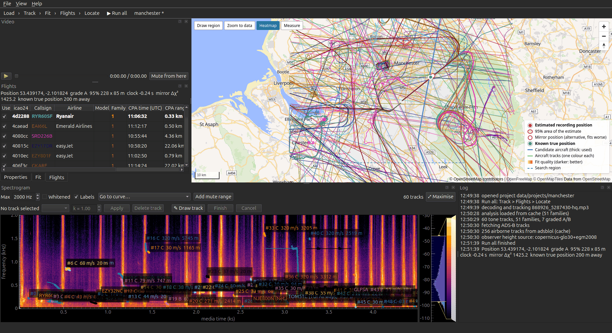
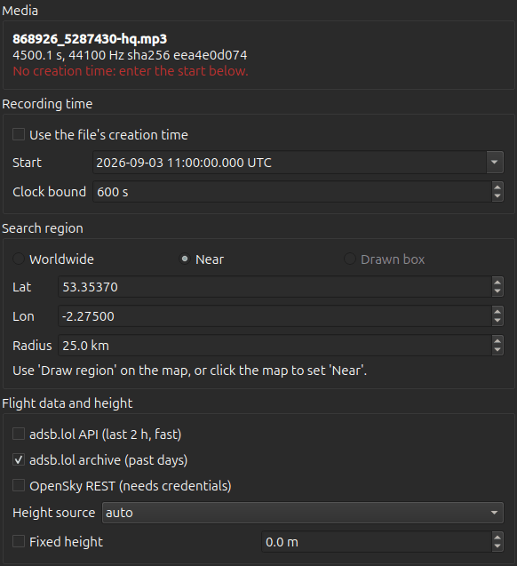
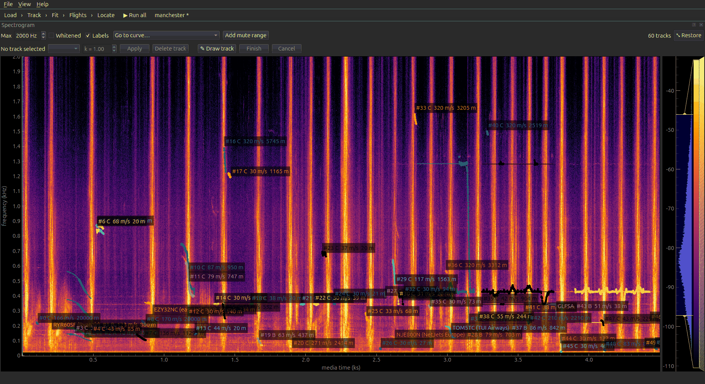
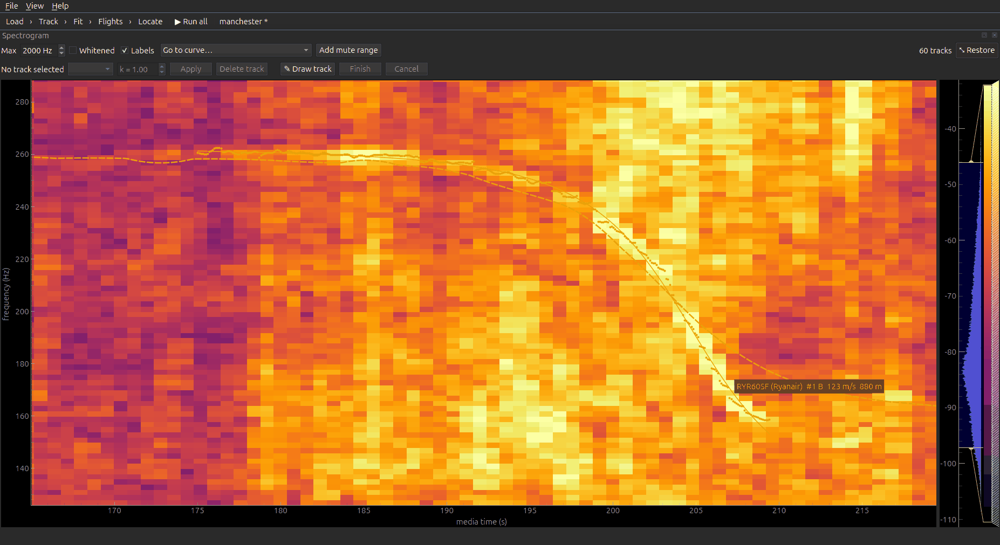
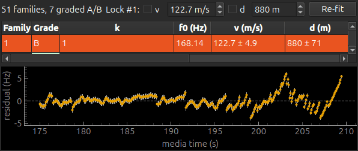
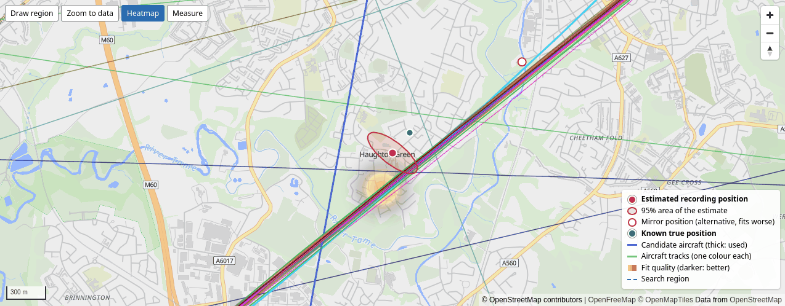
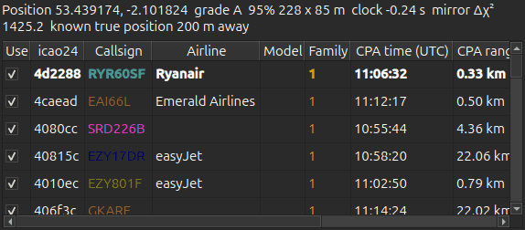
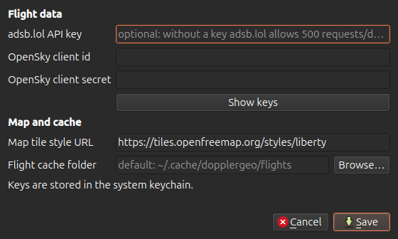

# dopplergeo

Find where a video was recorded from the sound of aircraft flying over it.

Every passing aircraft's engine tones slide from high to low (the Doppler
effect). The shape of that slide shows how fast the aircraft was going and how
close it came. dopplergeo extracts those curves from the audio, fetches the real
ADS-B flight tracks for the recording time, and finds the place on the ground
where the predicted curves match what the microphone heard. The result is a GPS
position with a 95% confidence ellipse on an OpenStreetMap map.



*The Manchester test recording (a 75-minute clip under the Manchester airport
approach): six aircraft matched, grade A, 200 m from the recordist's geotag.*

Full design and physics: [SPEC.md](SPEC.md).

> **Privacy.** Locating where someone else's video was recorded can reveal where
> they live or were. Only analyse recordings you made or have permission to
> analyse.

## Contents

- [What you need](#what-you-need)
- [Install](#install)
- [Quick start: the Manchester example](#quick-start-the-manchester-example)
- [Using the desktop app](#using-the-desktop-app)
- [Reading the result](#reading-the-result)
- [Command line](#command-line)
- [Flight data sources and API keys](#flight-data-sources-and-api-keys)
- [Troubleshooting](#troubleshooting)
- [Project status](#project-status)
- [Code layout](#code-layout)

## What you need

| Input | Notes |
| --- | --- |
| A video or audio file with an aircraft flyover | MP4, MOV, MKV, MP3, WAV, FLAC… Jets on approach or departure and turboprops work best. A clean, steady tone that slides down is what the tracker needs. |
| The recording's start time (UTC), within ±10 min | Read from the file's metadata when it has any (phone videos usually do). Otherwise you enter it. The exact clock offset is solved for. |
| A rough search region | A centre and radius (e.g. 25 km around the nearest airport) or a box drawn on the map. Worldwide search works too, but needs at least two aircraft in the clip. |
| ADS-B data for that time | Fetched automatically: free adsb.lol archive for past days, the adsb.lol API or OpenSky for recent recordings. See [Flight data sources](#flight-data-sources-and-api-keys). |

More aircraft in the recording means a better position. One straight pass leaves
a "mirror" answer on the other side of the flight path. Two or more aircraft at
different headings give a single point.

## Install

Python 3.11 or newer.

```bash
git clone <this repo> && cd doppler-flight-geolocator
python3 -m venv .venv
.venv/bin/pip install -e '.[gui,dem]'      # gui = desktop app, dem = terrain heights (rasterio)
```

For the command line only, use `.[dem]`. For development, add `test` and run
`.venv/bin/pytest`.

Linux: the map uses QtWebEngine and needs WebGL (any normal GPU driver). See
[Troubleshooting](#troubleshooting) for VMs and remote desktops.

## Quick start: the Manchester example

The test audio is not in the repo (Freesound licences vary). Get the
[Freesound 868926](https://freesound.org/s/868926/) clip "Haughton Green Planes"
(CC0), save its HQ preview as `data/freesound/868926_5287430-hq.mp3`, then:

```bash
.venv/bin/dopplergeo-gui data/freesound/868926_5287430-hq.mp3
```

1. In **Properties**, untick *Use the file's creation time* (an MP3 has none) and
   set **Start** to `2026-09-03 11:00:00 UTC`. Set the **Clock bound** to 600 s.
2. Under **Search region** choose **Near** and enter `53.3537`, `-2.2750`
   (Manchester airport), radius 25 km. Or click the map there.
3. Tick only **adsb.lol archive (past days)**.
4. Press **▶ Run all** (Ctrl+R).

The first run downloads and indexes the adsb.lol day (about 3 GB, once; the app
asks first) and tracks the full 75 minutes of audio (a few minutes). Later runs
reuse both caches and finish in about two minutes.

## Using the desktop app

```bash
.venv/bin/dopplergeo-gui                        # empty window
.venv/bin/dopplergeo-gui flyover.mp4            # open a media file
.venv/bin/dopplergeo-gui path/to/project        # open a saved project folder
```

Options: `--cache DIR` (flight cache, default `~/.cache/dopplergeo/flights`) and
`--no-basemap` (plain background instead of online map tiles, e.g. offline).

The window has the map in the middle and dockable panels around it: **Video**,
**Properties / Fit / Flights** (tabs), **Spectrogram** and **Log**. Rearrange or
re-open them from the **View** menu. The toolbar is the workflow, worked left to
right:

**Load › Track › Fit › Flights › Locate** and **▶ Run all**

Every step stays live. If you go back and edit a track, the later steps run again
from there. The status bar shows the running step, its stage and elapsed time,
and a **Cancel** button.

### 1. Load: open the recording and set the inputs

*File › Open media…* (or **Load**) opens a video or audio file. Opening a file
starts tracking straight away.



The **Properties** tab holds this recording's inputs:

- **Media**: file name, length, sample rate and SHA-256. It warns in red when the
  file has no creation time.
- **Recording time**: use the file's own creation time, or type a **Start** in UTC.
  **Clock bound** is how far that time may be from true UTC; the exact offset is
  solved for. Phone videos are usually right to within a second. Use 120–600 s
  for re-encoded or messenger-forwarded videos.
- **Search region**: **Worldwide**, **Near** (a centre and radius; clicking the
  map sets the centre), or **Drawn box** (*Draw region* on the map, then drag).
- **Flight data and height**: which ADS-B sources to try, in order: adsb.lol API
  (last 2 h), adsb.lol archive (past days), OpenSky REST (needs credentials).
  **Height source** is the observer's ground height: `auto` uses the Copernicus
  terrain model, else airport ground height from ADS-B. Tick **Fixed height** if
  you know it.

If the GPS tag from the file or a reference position is known, the map shows it
as *Known true position*. It is only for comparison and never used by the
solver.

<br clear="right">

### 2. Track: find the engine tones

**Track** builds the spectrogram, follows every tonal line through time, groups
harmonics of the same engine into *families*, and fits a Doppler curve to each
family.



Each coloured line is a tone track. Each label gives the family number, the fit
grade (A/B/C), and the fitted speed and closest distance. After Locate, the
matched aircraft's callsign is added. The bright vertical bands are aircraft
passing overhead: broadband jet noise.

Pick a curve in **Go to curve…** to zoom to it:



*One pass (Ryanair RYR60SF, 330 m from the solution). Dots: the tracked tone. Solid
line: the fitted Doppler curve. Dashed line: the curve predicted from the real
ADS-B track at the solved position. If the dashed line sits on the measured tone,
you can trust the result.*

Spectrogram controls:

| Control | What it does |
| --- | --- |
| **Max** | Highest frequency shown |
| **Whitened** | Show dB above the local median, which is what the tracker sees |
| **Labels** | Show or hide the curve labels |
| **Go to curve…** | Zoom to one Doppler curve |
| **Add mute range** | Exclude a time range (speech, cars, music) from tracking. Drag its edges; Track runs again. The Video panel's *Mute from here / End mute here* does the same at the playhead. |
| **⤢ Maximise** | Let the spectrogram fill the window |
| Click a track | Select it. Then move it to another family or a new one, set its harmonic number **k**, **Apply** (re-fits), or **Delete track** |
| **✎ Draw track** | Click along a tone the tracker missed. Each click snaps to the strongest bin within ±4 Hz. **Finish** adds it as a new family. |

Mouse wheel zooms, drag pans, and a click moves the playhead (video, map aircraft
icons and spectrogram stay in sync).

### 3. Fit: check the Doppler fits



The **Fit** tab lists every family with its grade, harmonic numbers k, rest
frequency f₀, speed v and closest distance d (± 1σ), and the closest-approach
time. Select a row to see its residuals (measured minus fitted frequency) below.

Grades: **A** = tight and well-covered fit, **B** = usable, **C** = poor or
missing its closest approach. The solver relies mainly on A and B families.

**Lock v / d** holds the selected family's speed or distance at a value in the
next fit, e.g. a known landing speed. **Re-fit** fits again from the tracks as
edited (Track does this automatically after an edit).

<br clear="right">

### 4. Flights: fetch the ADS-B tracks

**Flights** fetches every aircraft in the time window (start ± 2 min ± the clock
bound) and the search region plus 20 km. The cache is tried first, then the
ticked sources in order. The tracks appear on the map, one colour each. The log
reports how many airborne tracks came from which source.

### 5. Locate: solve for the position

**Locate** gates candidate aircraft by speed and timing, runs a grid search over
the region, refines the best minima, and tests the mirror solution.



On the map:

- **Red dot**: estimated recording position. **Red ellipse**: its 95% area.
- **Hollow red circle**: the mirror position (the alternative on the other side of
  a flight path, rejected when it fits clearly worse).
- **Green dot**: the known true position (GPS tag or reference), if any. Click it
  for details.
- **Orange heatmap**: grid-search fit quality (darker is better). Toggle it with
  **Heatmap**.
- Candidate aircraft tracks; the ones used in the solution are drawn thick.

Map buttons: **Draw region** (drag a search box), **Zoom to data**, **Heatmap**,
and **Measure** (click points to measure great-circle distances; double-click or
Enter finishes, Backspace removes the last point, Esc clears).



The **Flights** tab shows the one-line result above the candidate table: position,
grade, ellipse, clock correction, mirror Δχ² and the distance to the known
position. Each row shows the aircraft (callsign, airline, model when known), the
family it was matched to, the closest-approach time and range, the speed match
and χ². Assigned aircraft are bold. Untick **Use** to exclude an aircraft and
Locate again. Click a row to highlight it on the map and draw its predicted
Doppler curve on the spectrogram.

### Projects, export and settings

- *File › Save project* writes a project folder (`project.json` plus tracks). It
  stores the inputs, your track edits, mutes, fit locks and the last solution.
  The media is referenced by path and SHA-256, not copied. Analysis results are
  cached by content, so reopening a project is quick.
- *File › Export results…* writes `solution.json`, `solution.geojson`,
  `candidates.csv`, `tracks.csv`, `fits.csv` and `map.png` to a folder.
  *Export map PNG…* saves just the map.
- *File › Settings…* stores API keys in the OS keychain and sets the map tile
  style and flight cache folder:

<p align="center"></p>

## Reading the result

| Grade | Meaning |
| --- | --- |
| **A** | ≥ 2 aircraft, a single minimum, 95% ellipse under 500 m |
| **B** | One aircraft with the mirror ruled out, or an ellipse under 2 km |
| **C** | Mirror not resolved, ellipse over 2 km, or a good tone left unexplained. Treat as a band, not a point. |

Other numbers in the summary:

- **clock**: the correction to the file's start time that best explains the passes.
- **mirror Δχ²**: how much worse the mirror position fits. Above 9 it is rejected.
- **known true position N m away**: shown when a GPS tag or reference exists.

If the result looks wrong, check the zoomed spectrogram first. If the predicted
(dashed) curves do not sit on the measured tones, the match is wrong. Mute the
noisy parts, delete false tracks, draw a missed tone by hand, or exclude a wrong
aircraft, then Locate again.

## Command line

The same pipeline runs headless:

```bash
dopplergeo locate flyover.mp4 --near 52.31,4.76 --radius 30 --yes
```

It prints the position with its 95% ellipse, grade, which aircraft explained
which tone, the clock correction and any mirror solution. It writes
`solution.json`, `solution.geojson`, `candidates.csv`, `tracks.csv` and
`fits.csv` to `--out` (default `dopplergeo_out`).

Common options:

| Option | Use |
| --- | --- |
| `--start 2026-09-03T11:00:00Z` | Start time when the file has no creation time |
| `--clock-bound 120` | How far the file clock may be off, s (0 = trust it) |
| `--near LAT,LON --radius KM` / `--bbox S,W,N,E` | Search region; omit both for a worldwide search |
| `--providers adsblol-api,opensky,adsblol` | Flight data sources, in order |
| `--cache DIR` | Flight cache folder |
| `--yes` | Approve the large adsb.lol archive download |
| `--mute 120:135` | Exclude a time range (repeatable) |
| `--height M` / `--elevation auto\|dem\|adsb\|constant` | Observer height |
| `--weather none\|standard\|auto`, `--temp`, `--wind 6@240`, `--fit-wind` | Air model (default `none`: still air at 15 °C; the others are experimental) |
| `--clock-sigma`, `--adsb-lag-sigma` | Timing priors (see `--help`) |

The Manchester example from the command line:

```bash
dopplergeo locate data/freesound/868926_5287430-hq.mp3 --start 2026-09-03T11:00:00Z \
    --near 53.3537,-2.2750 --radius 25 --clock-bound 600 --providers adsblol --yes
```

Other commands:

```bash
# Tones and Doppler fits only (no flight data): tracks.csv, fits.csv
dopplergeo analyze flyover.mp4 --out out/

# Index one adsb.lol day into the cache (~3 GB streamed; the heatmap prefix is skipped)
dopplergeo adsblol-index 2026-11-12 --yes
# ... or from archive parts you downloaded yourself
dopplergeo adsblol-index 2026-11-12 --archive v2026.11.12-planes-readsb-prod-0.tar.a?

# List aircraft around a recording (±2 min, region + 20 km)
dopplergeo flights --start 2026-11-12T14:02:31Z --duration 240 --center 52.31,4.76 --radius 30
```

## Flight data sources and API keys

| Source | Covers | Key |
| --- | --- | --- |
| adsb.lol archive | Any past day (one ~3 GB download per day, indexed once into the local cache) | None. `GITHUB_TOKEN` lifts GitHub's 60 requests/hour limit for release lookups |
| adsb.lol API | The last ~2 hours (nearby aircraft are listed, then one trace request each) | Optional `ADSBLOL_API_KEY`; without one, 500 requests/day per IP, throttled after ~10 quick requests |
| OpenSky REST | The last hour (state vectors), tracks up to 30 days | `OPENSKY_CLIENT_ID` / `OPENSKY_CLIENT_SECRET` (OAuth2 client credentials) |

In the app, enter keys under *File › Settings…*; they are stored in the OS
keychain. A variable already set in the shell wins. The CLI reads the
environment variables. All flight data is cached under
`~/.cache/dopplergeo/flights` (or `--cache`), so a day or window is fetched only
once.

adsb.lol data is ODbL 1.0; OpenSky data needs the Schäfer et al. (2014) citation;
map tiles are © OpenStreetMap contributors via OpenFreeMap.

## Troubleshooting

| Problem | Fix |
| --- | --- |
| Map is blank or says it needs WebGL (VM, remote desktop, no GPU) | Start with `QTWEBENGINE_CHROMIUM_FLAGS=--enable-unsafe-swiftshader dopplergeo-gui` |
| QtWebEngine fails to start on Ubuntu 24.04 (sandbox) | `QTWEBENGINE_DISABLE_SANDBOX=1 dopplergeo-gui` |
| Offline | `--no-basemap`; everything except fetching new flight data still works from the caches |
| "No creation time" | Untick *Use the file's creation time* and enter the start, with a generous clock bound |
| No families, or only grade C | The audio has no clean tone (wind, speech, broadband jet roar). Mute the noise, try **Whitened** to spot faint lines, or **Draw track** along one |
| Wrong aircraft matched | Untick it in the Flights table and Locate again; check the predicted curves on the spectrogram |
| Result graded C with a mirror | One straight pass can't tell which side of the track you were. Use a longer clip with more aircraft |

## Project status

| Milestone | State |
| --- | --- |
| M1 Core physics (model, synthetic generator, single-pass fit) | done |
| M2 Audio pipeline | done |
| M3 Flight data (adsb.lol, OpenSky REST, cache, trajectories) | done |
| M4 Solver (gating, grid, refine, mirror, grading, observer height) | done |
| M5 Validation | in progress: Manchester real end-to-end test at 200 m from the geotag, grade A (6 aircraft, joint solve over the full 75-min file); GPS-tagged set pending |
| M6 GUI | done: Run all, track editing and hand drawing, fit locks, video mutes, settings with keychain, cached re-analysis; end-to-end GUI tests pass |
| M7 Polish (report/KML/PDF, settings parity, OpenSky Trino, packaging) | specified in SPEC.md, not started |

## Code layout

```
dopplergeo/
  core/
    media.py        PyAV demux, metadata (creation time, GPS tag), resample
    spectral.py     STFT, whitening
    tracking.py     DP ridge extraction (numba), harmonic grouping
    doppler.py      retarded-time Doppler model, single-pass fit, bootstrap
    pipeline.py     audio -> tracks -> families -> fits; windowed analysis, cache
    solver.py       gating, grid search, joint refine, mirror, grading
    forward.py      numba forward-model kernel (still or moving air)
    atmosphere.py   speed of sound, ISA lapse, wind
    elevation.py    observer height: Copernicus GLO-30 + EGM2008, airport ground
    geo.py          WGS84 / ECEF / ENU
    synthetic.py    synthetic flyovers and rendered audio for tests
  flights/
    base.py         TrackPoint schema, FlightProvider, track splines
    cache.py        Parquet parts + DuckDB coverage index
    adsblol.py      daily archive: release lookup, streamed traces/ indexing
    adsblol_api.py  adsb.lol API (recent recordings)
    opensky_rest.py OAuth2, /states/all, /flights/all + /tracks/all
    service.py      cache first, then providers in order
    ground.py       airport ground height from on-ground ADS-B
  gui/              PySide6 app: main window, panels, MapLibre map + bridge, workers
  locate.py         media -> families -> flights -> solution; outputs (CLI and GUI)
  global_search.py  worldwide search
  weather.py        Open-Meteo temperature and wind
  project.py        project.json schema
  cli.py            dopplergeo command line
tests/              unit, property, synthetic end-to-end and GUI tests
examples/           demos and Manchester benchmarks
docs/screenshots/   images in this README
```
